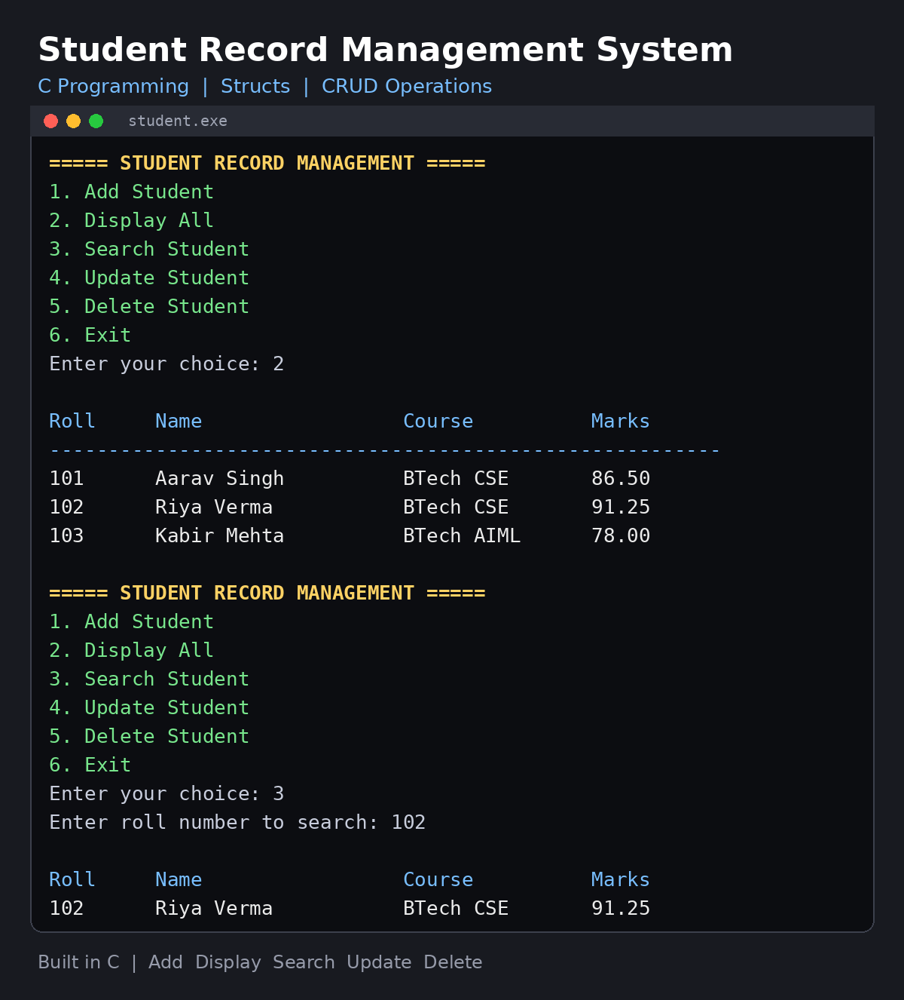

# Student Record Management System (C)



A simple menu-driven console application in C to manage student records.
Built as part of my BTech CSE (AI & ML) first-year learning.

## Features
- Add a student (roll number, name, course, marks)
- Display all records in a table format
- Search a student by roll number
- Update an existing record
- Delete a record
- Duplicate roll numbers are not allowed
- Handles invalid menu input without crashing

## Concepts Used
- Structures (`struct`)
- Arrays of structures
- Functions
- Loops and `switch-case`
- Input handling with `scanf`
- Formatted output with `printf`

## How to Run
```
gcc student_record_system.c -o student
./student
```
(Windows: `student.exe`)

## Limitations
- Data is stored in memory only, so records are lost when the program exits
- Maximum 100 students

## Future Improvements
- Save and load records using file handling
- Sort by marks / name
- Use dynamic memory allocation (`malloc`)
